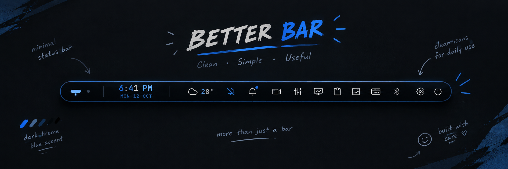

<div align="center">

# Better Bar

**A modern dynamic-island status bar and dock for Hyprland on Wayland, built with Quickshell.**

[](https://github.com/pxllbt/better-bar/actions)
[](https://quickshell.outfoxxed.me)
[](https://hyprland.org)
[](#-00-idle-cpu-architecture)
[](LICENSE)

<br/>



<br/>

*Clean · Simple · Useful — More than just a bar.*

[Features](#-features) • [Installation](#-installation) • [Keybindings](#-keybindings) • [Performance](#-00-idle-cpu-architecture) • [Contributing](#-contributing)

</div>

---

## 🌟 Overview

**Better Bar** is a status bar that stays out of your way until you need it. 

Instead of cluttering your screen with persistent heavy panels, a compact capsule sits flush at the top edge of your monitor. Pointing at or tapping it seamlessly morphs the bar in-place into whatever surface you need — media player, calendar, audio mixer, system monitors, network controls, or a 27-theme visual gallery. Surfaces that aren't open cost **zero pixels on screen and 0.0% CPU in the background**.

Along the bottom, an optional floating dock hosts your pinned and active applications with smooth magnification and multi-window previews that respect your cursor position.

---

## ✨ Features

### 🏝️ Dynamic Island Morphing
- **One element carries every state**: The rest pill morphs directly into expanded cards with smooth bezier curves — no popping dialogs or disconnected windows.
- **Surface suite**: Launcher, media card, audio mixer, wallpaper browser, calendar, clipboard history, Wi-Fi, Bluetooth, battery monitor, power controls, notifications, and settings.
- **🔖 Live Scratchpad Alert**: Automatically detects Hyprland's `special:scratchpad` (`SUPER + S`) and morphs the pill into an active indicator chip.

### 🎨 27-Theme Visual Gallery & 1-Tap Switching
- **Built-in theme showcase**: Browse all 27+ Omarchy themes (Catppuccin, Tokyo Night, Nord, Gruvbox, Hackerman, Everforest, and more) directly from the bar.
- **Live color ribbons**: Every theme card displays 5-stop color chips showing background, foreground, and primary tones.
- **Instant sync**: One tap applies the theme across Hyprland, Better Bar, terminals, and editors with zero lag.

### 🌈 Adaptive Wallpaper × Theme Harmony
- **Hybrid color blending**: Samples vibrant dominant tones from your active desktop wallpaper and harmonizes them mathematically with your current theme's accent.
- **One-tap harmony swatches**: Choose between pure theme accent, wallpaper extraction, or balanced 50/50 fusion.

### 🎵 Crystal-Clear Rotating Media CD
- **Physical vinyl metaphor**: Spinning album disc during playback with precision cropping (`PreserveAspectCrop`).
- **Unobstructed artwork**: Minimal outer-rim micro-grooves and a compact center spindle hub keep album covers rich, sharp, and vivid.

### 🚀 Floating Application Dock
- **Pinned & running apps**: Separated by a hairline divider with auto-hide, running-app indicator pips, and custom float spacing.
- **Multi-window previews**: Hovering an app with multiple windows opens interactive window selector cards.
- **Independent styling**: Custom glass opacity, tints, and themes independent of the top pill.

---

## ⚡ 0.0% Idle CPU Architecture

Unlike traditional bars that poll continuously or run 60 FPS background timers, Better Bar is engineered for **zero background resource drain**:

- **Audio Visualizer Auto-Suspend**: Cava's FFT pipewire stream runs only while music is actively playing, dropping to 0% CPU when audio pauses.
- **Event-Driven Window Tracking**: Replaced high-frequency dock timers with direct Hyprland IPC event listeners (`activewindow`, `openwindow`, `closewindow`).
- **Resting Canvas Dormancy**: Software 2D canvas repaints pause while the bar rests, preventing continuous Scene Graph FBO re-renders.
- **Single-Monitor Optimization**: Disables redundant `hyprctl cursorpos` polling on single-display setups.

*Result: Better Bar rests at **0.0% CPU** in `top` when idle.*

---

## 📦 Installation

### Option 1: Omarchy Plugin (Recommended)

If you use [Omarchy](https://omarchy.org), install Better Bar directly as a managed plugin:

```bash
omarchy plugin add https://github.com/pxllbt/better-bar.git --enable
```

To update later:
```bash
omarchy plugin update pix.bar
```
*(Or click **Update** in the bar's own settings surface).*

---

### Option 2: Standalone Installation

To run Better Bar as a standalone Quickshell bar on any Hyprland desktop:

```bash
curl -fsSL https://raw.githubusercontent.com/pxllbt/better-bar/master/remote-install.sh | bash
```

This clones the repository to `~/.local/share/quickshell/better`, checks dependencies, configures zero-CPU optimizations, and installs Omarchy theme hooks.

Then add these lines to your `hyprland.conf`:

```conf
# Autostart Better Bar with jemalloc memory decay settings
exec-once = ~/.local/share/quickshell/better/launch.sh

# Wallpaper daemon
exec-once = awww-daemon
```

---

## ⌨️ Keybindings

Better Bar surfaces can be invoked via Quickshell IPC. Add these shortcuts to your `hyprland.conf`:

```conf
# Launcher & Menus
bind = SUPER, slash,   exec, qs -p ~/.local/share/quickshell/better ipc call better launcher ""
bind = SUPER, SPACE,   exec, qs -p ~/.local/share/quickshell/better ipc call better launcher ""

# Quick Surfaces
bind = SUPER, SHIFT+W, exec, qs -p ~/.local/share/quickshell/better ipc call better wallpaper ""
bind = SUPER, SHIFT+V, exec, qs -p ~/.local/share/quickshell/better ipc call better clipboard ""

# System & Lock
bind = SUPER, L,       exec, ~/.local/share/quickshell/better/scripts/lock.sh
```

*(If installed via the Omarchy plugin, replace `qs -p ... ipc call better` with `omarchy-shell better`).*

Available IPC surface targets: `launcher`, `wallpaper`, `clipboard`, `mixer`, `calendar`, `media`, `power`, `battery`, `sysmon`, `link`, `theme`.

---

## 🧪 Testing

Better Bar includes comprehensive unit and integration test suites:

```bash
# Run unit tests (Node.js)
node lib/border-geometry.test.mjs
node lib/monitors.test.mjs

# Run integration tests (Bash)
bash lib/media-pill.test.sh .
bash lib/strip-layout.test.sh .
bash lib/surfaces-wired.test.sh .
bash lib/theme-sync.test.sh .
```

All test runs are continuously validated via [GitHub Actions CI](https://github.com/pxllbt/better-bar/actions).

---

## 🤝 Contributing

Contributions, bug reports, and suggestions are welcome!
- Please read our [Contributing Guide](CONTRIBUTING.md) for local development workflows.
- To report bugs or suggest enhancements, open an issue using our [Issue Templates](https://github.com/pxllbt/better-bar/issues).
- Security concerns can be reported via [SECURITY.md](SECURITY.md).

---

## 📜 Credits & License

- Built on [Quickshell](https://quickshell.outfoxxed.me) by **outfoxxed**.
- Pill and morphing-surface concepts adapted from [**Ukishima**](https://github.com/amanhex/Ukishima) by **amanhex** and [**Ricelin**](https://github.com/Gakuseei/Ricelin) by **Gakuseei**.
- Full lineage, licenses, and notices are documented in [NOTICE.md](NOTICE.md).

Distributed under the [MIT License](LICENSE).
